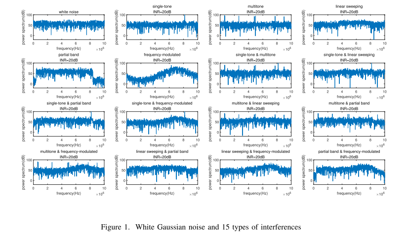
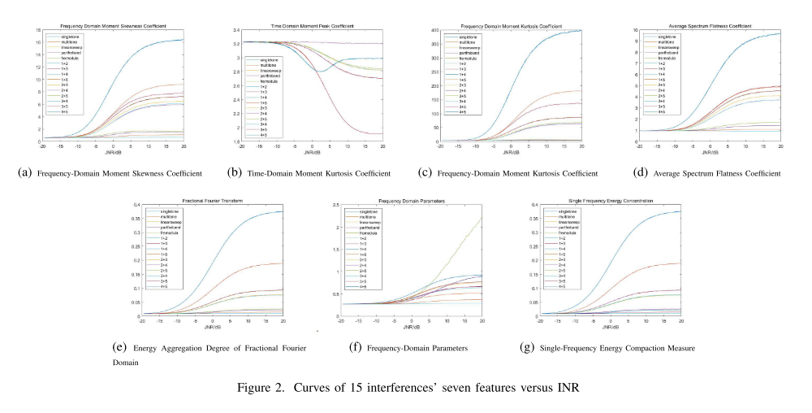
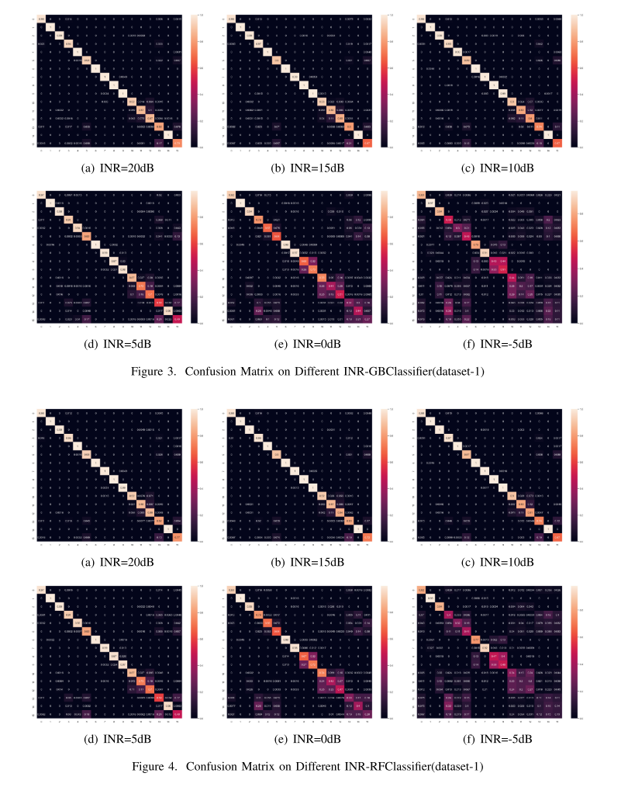

# Interference Signal Identification - Machine Learning-Based Complex Interference Recognition [MATLAB Code]

Introduction: With the widespread use of wireless communication and radar equipment, the available electromagnetic bands are becoming increasingly scarce, and the electromagnetic environment is becoming more complex. The complex electromagnetic environment inevitably leads to interference with each electromagnetic device. To ensure the capability of devices such as communication and radar systems, we can enhance their anti-interference capabilities to suppress interference. Since there is no universal suppression method for each type of interference, it is necessary to identify the interference and then perform specific suppression methods to handle it.
Typically, the problem of interference identification mainly involves two aspects of research, one is the feature extraction of different interferences, and the other is the study of classifiers. A large amount of research has focused on the feature extraction of interferences, such as wavelet analysis [1], time-frequency image transformation [2], short-time Fourier transform [3], in order to obtain various useful features. Previous studies usually use these features to analyze and identify individual interferences. Some classification and recognition algorithms, using machine learning algorithms [4], are based on a small number of extracted features, while some algorithms, using neural networks [5], directly use the interferences, so that the classification without feature extraction has very high training complexity.
Therefore, in order to adapt to the actual electromagnetic environment, this paper focuses on the identification of complex interferences and simulates mixed interferences that are not commonly seen in previous work. In the first stage, we use the features extracted from single interference samples and then use multiple classifiers to identify interferences. Secondly, in order to improve performance, we combine multiple interference samples for feature extraction. These extracted features are much smaller than the original interference signals. Therefore, when using these features as a dataset, it can significantly reduce the training complexity. Test results show that when INR≥5dB, the accuracy of this method exceeds 90%.
Article illustrations: Single tone, multitone, linear sweep frequency, partial band, frequency modulation interference and 22 combined interference types
Feature parameters: Frequency domain moment skewness coefficient, time domain moment kurtosis coefficient, frequency domain moment kurtosis coefficient, average spectral flatness coefficient, fractional Fourier domain energy concentration degree, single frequency energy compaction measurement
Confusion matrix:
Conclusions present 15 types of interference, including 5 basic interference types and their mixed interference types, and extract 7 useful features. Based on the extracted features, we employ gradient boosting classifier, random forest classifier, and fully connected neural network to identify interference. Two different datasets are constructed for training, and examples are provided to demonstrate the confusion matrix, showing that the proposed neural network has good recognition accuracy. Our future research will emphasize better neural networks in more complex interference situations.

## Images

<!-- PAYMENT_BLOCK -->

## Get this dataset

- Payment link (Stripe): [Buy now](https://buy.stripe.com/3cs8yP7sY87d0vu9AB)
- Payment QR code: 

<!-- /PAYMENT_BLOCK -->
